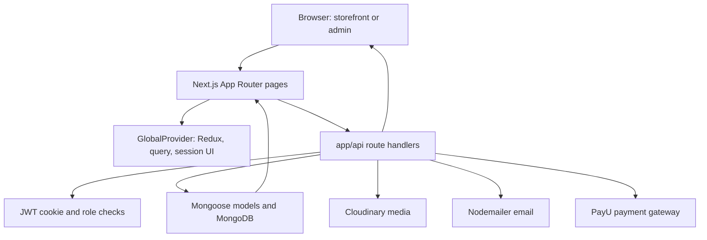

# Architecture

## System overview

Narumugai is a Next.js 15 App Router application. React pages and client components provide a public storefront and protected administration experience. Route handlers under `app/api` implement application operations, Mongoose models persist commerce records in MongoDB, and integrations connect to Cloudinary, Nodemailer, and PayU. Redux Toolkit and Redux Persist manage browser-side cart, wishlist, and authentication state. There is no separate service or API server in this repository.

## Active persistence and authentication decision

- **Live storefront and admin:** MongoDB through Mongoose in `models/` and `app/api/`.
- **Live identity:** the `access_token` JWT cookie, checked by `lib/authentication.js` in API handlers and by middleware for protected pages. The browser fetches the current user summary from `/api/auth/session`; Redux holds that summary in memory only.
- **PostgreSQL V2:** migration work only. Its `/api/v2/*` routes return 404 unless `ENABLE_V2_API=true` is explicitly set. The flag must stay disabled until a planned data migration, identity cutover, and production acceptance are complete.
- Keep new storefront and admin work on the MongoDB path until a separate cutover is approved. Do not dual-write a commerce operation to MongoDB and PostgreSQL.

## Major components



## Request and data flow

1. Next.js resolves a URL to a page in `app/(root)/(website)`, `app/(root)/(admin)`, or `app/(root)/auth`. Parentheses denote route groups and do not appear in public URLs.
2. The root layout installs theme, global providers, toast notifications, and cookie UI. The website layout adds storefront chrome; the admin layout provides the admin shell.
3. Client interfaces call same-origin `/api/...` handlers. A handler validates the request, checks authorization where implemented, connects through `connectDB()` in `lib/databaseConnection.js`, reads or mutates Mongoose documents, and returns JSON or a redirect.
4. Authentication uses a signed JWT in the `access_token` cookie. `middleware.js` verifies it for `/admin`, `/my-account`, and `/auth`, and gates the dormant V2 API. Legacy Mongo API handlers perform their own authorization checks.
5. Checkout creates a pending order and reserves inventory in one MongoDB transaction, then initiates PayU. `/api/payment/verify` verifies the gateway callback and applies the payment transition. Inventory is stored in `ProductVariant.quantity` when size/color variants exist; `Product.quantity` is used only for a product without variants. `lockedQuantity` is retired from the active model.

## Page map

| URL area | Main experience |
|---|---|
| `/` | Storefront home, featured content, banners and product discovery. |
| `/shop`, `/categories`, `/categories/{category}` | Product browsing and category-specific listings. |
| `/product/{slug}` | Product detail, variant selection, review and purchase actions. |
| `/cart`, `/checkout`, `/payment-success`, `/payment-failure` | Cart, checkout and payment result flows. |
| `/wishlist` | Saved products. |
| `/orders`, `/order-details/{orderid}`, `/profile`, `/my-account` | Customer orders, profile and account dashboard. |
| `/auth/login`, `/auth/register`, `/auth/reset-password` | Authentication and password recovery. |
| `/admin/dashboard` | Admin overview. `/admin/product`, `/admin/product-variant`, `/admin/category`, `/admin/coupon`, `/admin/orders`, `/admin/customers`, `/admin/review`, `/admin/media`, `/admin/banners`, `/admin/sliders`, and `/admin/trash` provide management screens. |
| `/about-us`, `/privacy-policy`, `/terms-and-conditions`, `/shipping-policy`, `/return-policy`, `/refund-policy` | Informational and policy pages. |

## Data model

| Model | Purpose and key relationships |
|---|---|
| `User` | Customer/admin identity, role, password hash, email verification, profile and embedded cart. |
| `Product` | Catalog item with slug, category, media, price, quantity, availability and soft-delete timestamp. |
| `ProductVariant` | Product-specific color/size/SKU and variant-level price, media, and stock. |
| `Category` | Named and slugged product grouping. |
| `Order` | Customer/contact/address snapshot, line items with explicit product-vs-variant inventory source, totals, payment identifiers/status, and lifecycle state. |
| `Coupon` | Code, percentage, minimum spend, validity and soft-delete timestamp. |
| `Media` | Cloudinary identifiers and URLs plus descriptive metadata. |
| `Review` | Product/user-linked rating and review content. |
| `Banner`, `Carousel` | Media-linked promotional content, ordering, activation and placement. |
| `OTP` | Expiring email sign-in and email-verification codes. |
| `PasswordResetToken` | Hashed, expiring, one-time password reset token. |

The model definitions in `models/` are the source of truth for MongoDB fields and collection names. Some records use `deletedAt` for soft deletion. Variant products use variant quantity as inventory; non-variant products use product quantity. Piece counts are nonnegative integers. The old public stock mutation routes are disabled; payment initiation owns reservation and the verified payment callback owns failure restoration.

## Source layout

```text
app/                  App Router pages, layouts, metadata, and API handlers
  (root)/              Storefront, admin, and authentication route groups
  api/                 JSON and payment/stock route handlers
components/            Shared UI, website components, admin components, primitives
hooks/                 Client hooks for data, window size, and mutations
lib/                   Database, auth, Cloudinary, email, stock, validation, helpers
models/                Mongoose schemas and model registration
store/                 Redux store, reducers, and middleware
routes/                Shared page-path constants
scripts/               Database/network utility scripts
email/                 Transactional email renderers
public/                 Public static assets and email images
docs/                   Project documentation and implementation notes
```

## Important boundaries

- `middleware.js` protects selected page paths and disables `/api/v2/*` by default. Legacy Mongo API routes must perform their own authentication and role checks.
- `lib/databaseConnection.js` reads `MONGODB_URI` and caches the Mongoose connection on `global` for reuse.
- `next.config.js` permits optimized remote images from `res.cloudinary.com` and configures long-lived cache headers for image/static asset paths.
- PayU integration is implemented in `app/api/payment/`; the repository also contains Razorpay as a dependency, but the active payment route code references PayU settings.
