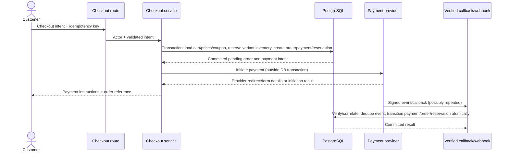
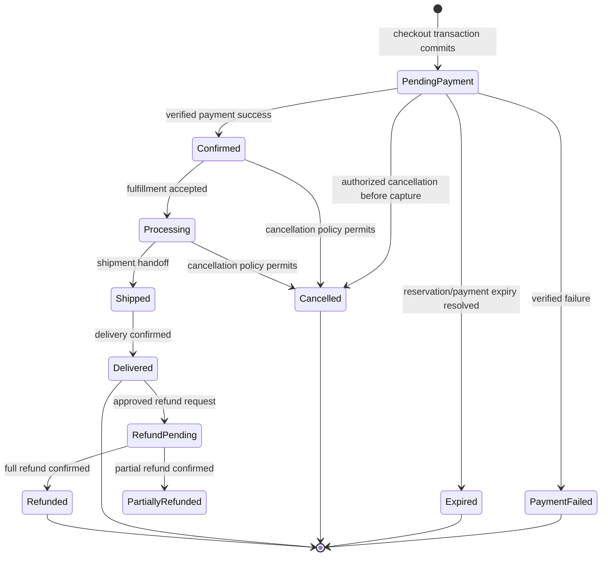
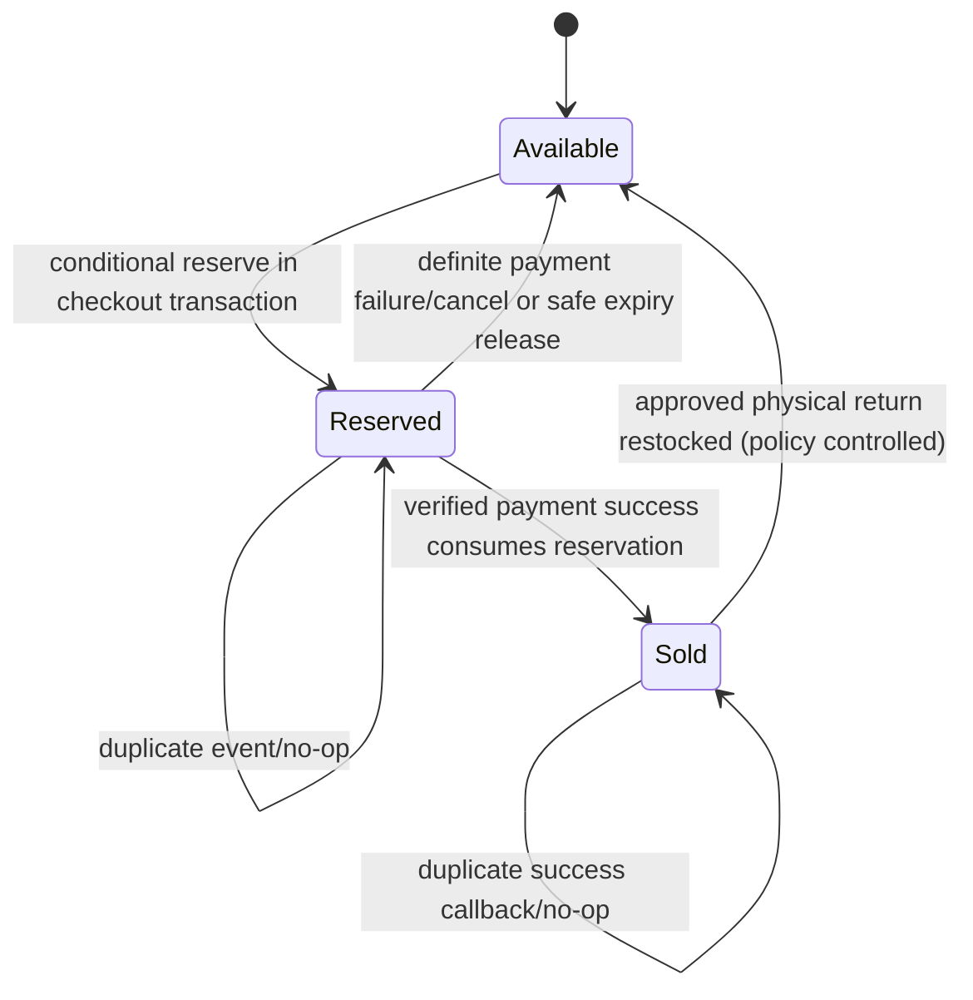

# V2 commerce state machines

**Status:** Proposed lifecycle and invariants. Exact cancellation, expiry, and refund policy needs business confirmation before implementation.

## Checkout sequence



If provider initiation times out, do not assume the provider created no payment. Mark the payment outcome as unknown/pending and reconcile. Release stock only when the payment outcome is definitively failed/cancelled or the reservation expiry policy has safely resolved the payment state.

## Order lifecycle



Transitions are performed by server use cases, never by client-provided status. Admin transitions must be explicit and audited. Cancellation/refund eligibility and shipment states need confirmed policy; the diagram marks intended lifecycle, not authorization to bypass provider refund flows.

## Inventory lifecycle

For a variant inventory row, define:

```text
available = on_hand - reserved
on_hand >= 0
reserved >= 0
reserved <= on_hand
```

`sold` is a reporting/ledger concept, not free stock. A successful payment consumes the reservation by reducing both `on_hand` and `reserved`; an inventory movement records the sale. A release decreases only `reserved`. A return/restock is a separate authorized movement after the return/refund policy is decided.



The state is per reservation item and variant. A reservation belongs to a single order/checkout attempt and contains exact variant quantities. A caller cannot release inventory by submitting a variant ID and quantity alone.

## Concurrency and transaction rules

### Reserve

In one PostgreSQL transaction:

1. Claim/resolve the checkout idempotency key.
2. Load cart rows and current product/variant/coupon/address state.
3. Recalculate subtotal, discount, shipping/tax where configured, and total in integer minor units.
4. Reserve each inventory row with a conditional update that succeeds only when `on_hand - reserved >= requested_quantity`; lock/update rows in stable variant-ID order to reduce deadlocks.
5. Create immutable order and item snapshots, payment intent record, reservation, and reservation items.
6. Commit all local writes together. Any failed item rolls back the entire checkout.

### Initiate payment

Call the payment provider after the reservation/order transaction commits. Persist provider initiation state and provider references. If the provider definitively rejects creation, transition payment to failed and release reservation in a new transaction. An ambiguous timeout enters reconciliation; do not blindly release.

### Confirm payment

1. Verify provider signature and required fields before changing domain state.
2. Locate the payment using the immutable provider transaction/reference and compare order, amount, and currency.
3. Insert a unique provider event/dedupe record. A duplicate returns the already processed outcome.
4. In one transaction, lock payment/order/reservation rows, enforce allowed current states, update payment/order, consume reservation, and record inventory movement.
5. Commit. Send non-critical notification only after durable state is committed.

### Fail/release

A verified failure, authorized cancellation, or expiry handler locks the same payment/order/reservation rows and transitions only if the reservation is still active. It releases exact reservation items once. A repeated failure or a failure after success is a no-op or reconciliation exception; it must never add arbitrary stock.

## Idempotency and expiry

- Checkout requests have a unique idempotency key scoped to the authenticated actor (and cart where applicable).
- Provider event/callback dedupe keys are unique and transactionally claimed before applying side effects.
- Reservation expiry uses an explicit timestamp plus a scheduled/periodic worker or a host-supported scheduled invocation. The production scheduler and expiry duration are unresolved; Phase 11 must not ship without them.
- Expiry processing first resolves payment ambiguity with the provider when supported, then releases only still-active reservations. A stale browser page cannot release stock.

## Money and coupon rules

All price arithmetic uses integer minor units. The server recalculates product/variant price, coupon eligibility, and total from persisted records at checkout. A preview endpoint never guarantees a discount. Coupon redemption and usage-limit enforcement must occur transactionally at the policy-defined point; that point is still an open business decision.
