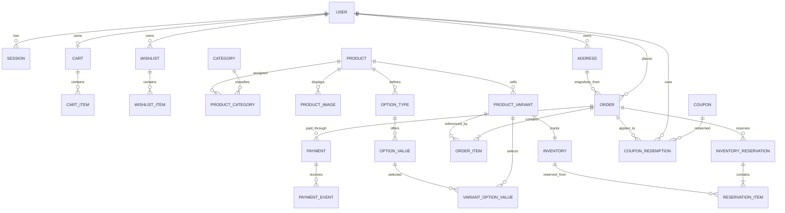

# V2 relational data model

Authentication portions of this original design are superseded: OTP verification and pending phone-based admin activation were removed. See [Authentication status](AUTHENTICATION.md). The current Prisma schema and migrations are authoritative.

**Status:** Identity, address, catalog, cart, wishlist, coupon, inventory, order, payment, reservation, and audit models are in the Prisma schema with additive migrations. Production data import remains out of scope until the documented dry-run and reconciliation gates pass.

## ER diagram

`PRODUCT_CATEGORY` is optional if the business confirms that each product has exactly one category. The current application uses one category per product; retain that simpler relation unless multi-category merchandising is explicitly required.

## Proposed entities

| Entity | Core fields and purpose |
|---|---|
| `User` | UUID, normalized unique phone, optional email, display name, role/status, timestamps. |
| `Session` | UUID, user FK, unique token hash, created/last-seen/expiry/revocation timestamps, optional user-agent/IP metadata with retention policy. Raw cookie token is never stored. |
| `Address` | UUID, user FK, recipient name, Indian E.164 contact phone, address lines, landmark, city, state, six-digit PIN, `IN` country code, explicit default flag, timestamps. Orders copy an immutable address snapshot. |
| `Category` | UUID, unique slug, name, active/soft-delete state, timestamps. Parent/category hierarchy only if confirmed. |
| `Product` | UUID, unique slug, title/description, active status, timestamps. Product is a catalog grouping, not the stock unit. |
| `ProductImage` | UUID, product FK, provider asset ID/URL, alt text, sort order. Preserve Cloudinary asset identifiers during migration. |
| `OptionType` | UUID, product FK, name (e.g. Color, Size, Fabric), display order; unique `(product_id, normalized_name)`. |
| `OptionValue` | UUID, option type FK, display value and normalized value; unique `(option_type_id, normalized_value)`. |
| `ProductVariant` | UUID, product FK, unique SKU, active status, price in integer minor units, optional compare-at price, timestamps. Every sellable product has at least one variant; products with no customer options use a single default variant. |
| `VariantOptionValue` | Variant FK + option value FK; unique pair. Validate option values belong to the variant's product. |
| `Inventory` | One row per variant: variant FK unique, on-hand quantity, reserved quantity, sold quantity (if retained as a counter), version/timestamps. Available is `on_hand - reserved`; never accept it from the client. |
| `Cart` | UUID, optional user FK, optional unique guest-token hash, timestamps. A database constraint enforces exactly one owner: user or guest token. Guest token is high entropy and stored only as a hash; the raw token exists only in a Secure, HttpOnly, SameSite cookie. |
| `CartItem` | Cart FK, variant FK, positive quantity, unique `(cart_id, variant_id)`, timestamps. Cart prices are not authoritative snapshots. |
| `Wishlist` / `WishlistItem` | User-owned list and unique variant/product membership. Decide product-level versus variant-level wishlist semantics before Phase 8. |
| `Coupon` | Unique normalized code, discount kind/value, minimum spend, optional maximum discount, validity interval, global/per-user limits, active state. |
| `Order` | UUID, order number, nullable user FK for guest orders, immutable contact/address snapshot, `currency` fixed to `INR` initially, integer paise subtotal/discount/shipping/tax/total, order status, idempotency key, optional hashed guest access token, timestamps. |
| `OrderItem` | Order FK, optional variant FK for traceability, immutable product name/SKU/options/quantity/unit price/discount/tax/line total snapshots. Historical order display must not depend on current catalog joins. |
| `Payment` | Order FK, provider, provider transaction/reference IDs, amount in paise, `currency = INR`, status, idempotency key, initiation/confirmation timestamps, safe provider metadata. Unique provider transaction identifier where present. |
| `PaymentEvent` | Payment FK, unique provider event/callback ID or dedupe key, verification result, received/processed timestamps and minimal payload digest. Avoid storing unnecessary sensitive payloads. |
| `InventoryReservation` | Order FK, unique reservation key, status, created/expiry/released/consumed timestamps. One logical reservation per checkout attempt/order. |
| `ReservationItem` | Reservation FK + inventory FK, positive quantity, unique pair. The rows identify exactly what can be released or consumed. |
| `CouponRedemption` | Coupon, user, order FKs and redemption timestamp; unique policy key to enforce once-per-user/order limits transactionally. |
| `InventoryMovement` (recommended) | Inventory FK, movement kind, quantity delta, reference to order/reservation/admin action, actor, timestamp. Provides an auditable stock ledger; scope and retention to confirm in Phase 7. |

## Relational invariants

- Use PostgreSQL UUID primary keys and explicit foreign keys with deliberate deletion behavior. Do not cascade-delete orders, payment events, or inventory history when a catalog item/user is removed.
- `phone` is normalized to E.164 before uniqueness checks. Email is nullable and unique only when present, with case/normalization policy defined.
- V2 address records are India-only: contact phones use `+91` followed by a valid 10-digit mobile number, PIN codes contain six digits and start from 1–9, and country code is fixed to `IN`. No address becomes default automatically; the user explicitly selects one. A user may have zero or one default address, and deleting the default does not select another address.
- Initial V2 prices and all monetary snapshots are INR integer paise. Do not store floating-point money or infer currency from locale.
- A cart has exactly one owner: a user or a guest-token hash. Login merge is a server transaction and revalidates product status, variant validity, quantity bounds, and stock; conflict behavior should be reported per item.
- Guest order access uses an authenticated owner or a separate high-entropy token. A guessable order number is never an access credential.
- All quantities are integers with `quantity > 0` for order/cart/reservation items and `on_hand >= 0`, `reserved >= 0`, `reserved <= on_hand` for inventory.
- Prices and totals use integer minor units (paise for INR) and an explicit ISO currency code. Avoid binary floating point for money.
- Each SKU is unique. Product slugs and normalized coupon codes are unique.
- An option combination must be unique within a product. A normalized deterministic `option_combination_key` on the variant is a practical unique constraint; service validation also checks option/value ownership.
- Checkout idempotency key is unique per actor/cart scope. Payment provider event identifiers are unique to make callback retries safe.
- A coupon redemption is inserted in the same transaction as the order policy requires, protected by a unique constraint and usage-limit check.
- Order item price/name/SKU/options and shipping address are snapshots. Updating a product or user address cannot rewrite completed history.

## Index plan to validate with real queries

- Sessions: unique token hash; `(user_id, expires_at)` and expiry/revocation lookup.
- Catalog: unique product slug, category/product association, active product listing sort keys, unique SKU, `(product_id, status)` variants.
- Option values: unique normalized value per option type; variant option join indexes in both directions.
- Inventory: unique `variant_id`; reservation/item foreign keys and expiry/status lookup.
- Carts: unique owner scope and unique `(cart_id, variant_id)`.
- Orders: unique order number, `(user_id, created_at DESC)`, `(status, created_at)`, and idempotency scope.
- Payments: `(order_id, created_at)`, unique provider transaction reference, event dedupe key.
- Coupons: unique normalized code and validity/active lookup; redemptions indexed by coupon/user and order.

Indexes should be finalized against the API access patterns and query plans in their feature phase, not added speculatively.

## Key modeling choices

- Inventory belongs to a sellable SKU/variant. An unconfigured product is represented by one default variant rather than a separate product-level inventory path.
- `available` is derived from on-hand minus reserved. A `sold` counter is useful for reporting but must not replace order history or an inventory ledger.
- Keep current catalog data normalized. Denormalize only immutable order snapshots or proven read-model needs.
- OTP delivery, notification queue, shipping/shipment tracking, and detailed admin permissions are not fully specified yet; do not create extra tables until their behavior is agreed.
