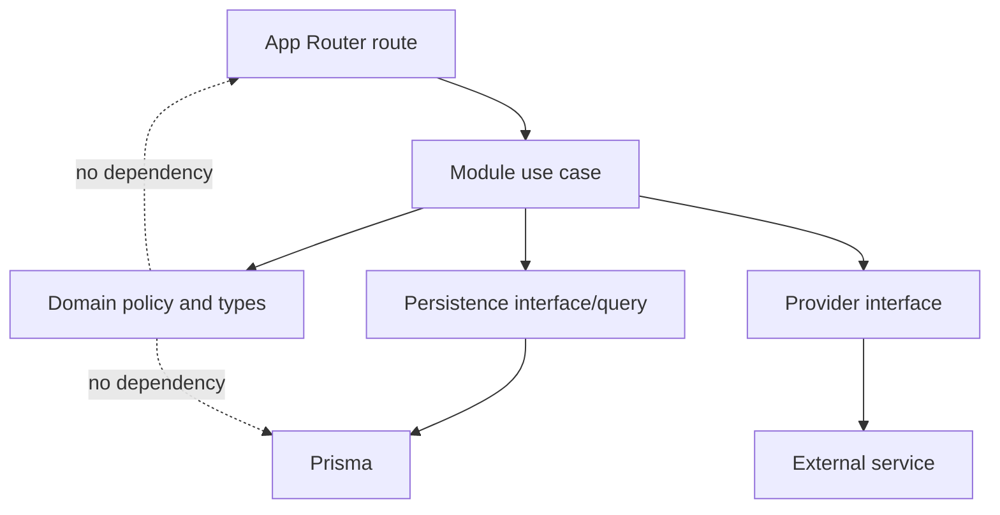

# V2 modules and API architecture

**Status:** Module boundaries and contracts. V2 session, profile, India-only addresses, public catalog, guest/user carts, product wishlists, coupon preview, checkout, PayU callbacks, owner-scoped orders, and core admin APIs now have route and service implementations. Production data migration, live provider verification, and some operational workflows remain gated.

## Module ownership

| Module | Owns | Depends on |
|---|---|---|
| `auth` | Session validate/revoke and shared auth errors. No V2 session creation or OTP flow is available. | User/session persistence. |
| `users` | Profile, optional email, account status, user-owned addresses. | Auth actor, user/address persistence. |
| `catalog` | Categories, products, images, listing/detail/search/filter. | Prisma catalog repositories, media references. |
| `variants` | Option definitions/values, valid combinations, SKU and variant pricing. | Catalog product and persistence. |
| `inventory` | Availability, reservation, release, consume/sale, stock adjustments and audit. | PostgreSQL transaction and inventory repositories. |
| `cart` | User- or guest-owned cart, selected variants, quantity rules, wishlist. | Auth/guest-cart actor, catalog/variant availability. |
| `coupons` | Eligibility, discount calculation, limits, redemption policy. | Cart/order pricing inputs and coupon persistence. |
| `orders` | Order creation/history/state, immutable item/address snapshots, cancellation policy. | User, cart, inventory, coupons, payments. |
| `payments` | Payment intent, provider adapter, callback verification, idempotent reconciliation/refund state. | Orders and inventory finalization contracts. |
| `admin` | Admin-only catalog, inventory, coupon, order, and user actions; authorization policy. | Domain use cases, not direct model writes. |
| `notifications` | Order/auth notification intent and provider adapters. | Persisted domain events/state; delivery mechanism remains a later choice. |

Suggested placement inside the existing App Router project:

```text
app/api/v1/...                 Transport routes only
src/modules/<module>/          schemas, services/use-cases, domain types
src/db/prisma/                 Prisma client/schema/migrations (exact location to align with tooling)
src/repositories/              Only persistence seams shared or materially useful
src/lib/auth/                  Session and actor resolution
src/lib/errors/                Domain errors and HTTP mapping
src/lib/validation/            Shared validation helpers
src/lib/providers/              PayU, SMS, email, and media adapters
```

This is a logical ownership map, not a required mass file move. Keep existing `app/` pages and migrate routes feature by feature. Avoid a repository wrapper for trivial one-line queries; put query code in the owning module until a repository seam provides real value.

## Dependency direction



Domain policy must not import Next.js request/response types. Routes must not write Prisma queries directly for commerce workflows.

## Route contract

Every route should follow this sequence:

1. Resolve the server-side actor/session where required.
2. Parse path, query, headers, and body using a route-specific Zod schema; reject unknown or malformed input according to the API policy.
3. Invoke one named use case with actor context and validated data.
4. Return a stable response shape and correct HTTP status.
5. Map known domain errors centrally; log unexpected exceptions with a request/correlation ID and return a generic error.

Proposed common success shape:

```json
{ "data": {}, "meta": { "requestId": "..." } }
```

Proposed error shape:

```json
{
  "error": {
    "code": "INVENTORY_UNAVAILABLE",
    "message": "One or more selected items are no longer available.",
    "requestId": "..."
  }
}
```

Do not expose database errors, stack traces, or provider secrets. Use HTTP status as the authority (for example 400 validation, 401 unauthenticated, 403 unauthorized, 404 missing, 409 conflict, 422 domain validation, 429 rate limited, 500 unexpected failure).

## Proposed API surface

The exact path prefix is a design proposal. Keep public page URLs stable; introduce versioned APIs for V2 while legacy endpoints remain in place.

| Area | Proposed routes | Notes |
|---|---|---|
| Auth | `GET /api/v2/auth/session`, `DELETE /api/v2/auth/session` | Read or revoke a database-backed session. No public V2 login/session-creation flow is currently implemented. |
| Profile/address | `GET/PATCH /api/v2/users/me`, `GET/POST /api/v2/users/me/addresses`, `PATCH/DELETE /api/v2/users/me/addresses/:id` | Actor comes from session; never accept owner ID as authority. Profile and address routes are implemented. |
| Catalog | `GET /api/v2/products`, `GET /api/v2/products/:slug`, `GET /api/v2/categories` | Implemented with bounded pagination and allowlisted filters/sorts. |
| Cart | `GET /api/v2/cart`, `PUT /api/v2/cart/items/:variantId`, `DELETE /api/v2/cart/items/:variantId`, `POST /api/v2/cart` | Implemented for authenticated users and opaque-cookie guests. Login merges the guest cart and claims its guest orders. |
| Wishlist | `GET /api/v2/wishlist`, `PUT/DELETE /api/v2/wishlist/items/:productId` | Implemented as product-level membership for authenticated users. |
| Coupons | `POST /api/v2/coupons/validate` | Implemented as an advisory preview; checkout revalidates and counts active reservation holds. |
| Checkout/orders | `POST /api/v2/checkout`, `GET /api/v2/orders`, `GET /api/v2/orders/:orderNumber`, `POST /api/v2/orders/:orderNumber` | Implemented with server-loaded cart pricing, INR paise, idempotency, inventory reservations, immutable snapshots, and owner-scoped reads. Cancellation of paid orders enters admin-reviewed refund handling. |
| Payments | `POST /api/v2/payments/payu/callback` | Implemented for PayU response hash validation, callback dedupe, and inventory finalization. The reservation scheduler reconciles expired intents through PayU `verify_payment`. |
| Admin | `/api/v2/admin/categories`, `/products`, `/inventory`, `/coupons`, `/orders` | Implemented with server-side admin role checks and audit rows for mutations. |

## Checkout input and idempotency

The checkout request should express intent only, for example address ID or guest address fields, coupon code, and an idempotency key. The service loads the actor’s cart, current active variants and prices, coupon terms, and inventory from PostgreSQL. It calculates every monetary value on the server in INR paise. A repeated idempotency key returns the existing checkout/order result rather than creating another reservation or payment.

The server must reject a cart item whose variant is inactive, belongs to a deleted product, has an invalid option combination, exceeds quantity limits, or cannot be reserved. Return item-level conflict details without leaking other users’ data.

## Pagination, filtering, and observability

- Prefer cursor pagination for large/changing order lists; offset pagination is acceptable for small admin datasets with a hard maximum page size.
- Allowlist sortable/filterable fields. Never translate arbitrary client field names into ORM order clauses.
- Escape or use database-native search rather than compiling unrestricted user regexes.
- Attach request IDs to logs and responses. Record audit events for admin changes, payment callbacks, and inventory adjustments without logging secrets or full sensitive payloads.

## Adapter boundaries

Keep one active payment-provider implementation. The provider adapter should own request signing, callback parsing/signature verification, transaction/status lookup if available, and provider-specific error translation. Domain services receive a normalized event such as `PaymentSucceeded` only after verification. PayU is the initial candidate because it is the current active code path; confirm production merchant capabilities before Phase 12.

Phone OTP authentication was removed. Any older proposal below describing OTP or phone-based bootstrap is superseded by [Authentication status](AUTHENTICATION.md).

## First-admin bootstrap

V2 admin provisioning must be designed alongside a replacement authentication flow before V2 admin APIs are used. The former OTP-dependent bootstrap has been removed.
