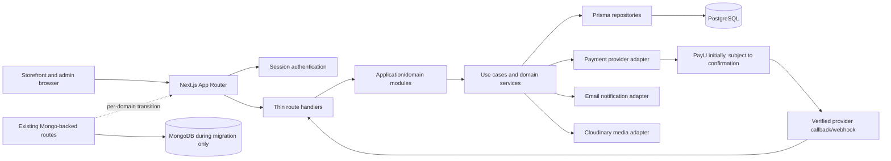

# V2 system architecture

**Status:** Target architecture with the V2 identity, profile, address, catalog, cart, wishlist, coupon preview, checkout, PayU, order, admin, and reservation reconciliation foundations implemented. The storefront still uses legacy Mongo-backed flows until a separately planned domain cutover.

## Shape

V2 remains one Next.js App Router deployment and one modular monolith. Route handlers are transport adapters. Domain modules own validation, business rules, and persistence contracts. PostgreSQL through Prisma is the transactional source of truth for migrated commerce domains. The browser presents user intent; server services load authoritative data and decide outcomes.

The callback arrow is provider-to-server. A browser success page or redirect is informational and cannot mark an order paid.

## Runtime responsibilities

| Layer | Responsibility | Must not own |
|---|---|---|
| App Router page/layout | Render pages, load presentation data, protect page navigation as a UX layer. | Authorization as the only security control; authoritative totals or inventory. |
| API route handler | Parse transport, authenticate, validate request, invoke a use case, map known errors to HTTP. | Multi-step business workflows or ad hoc Prisma transactions. |
| Module service/use case | Apply domain policies, orchestrate transaction boundaries, call provider adapters where appropriate. | HTTP response construction or UI state. |
| Repository | Encapsulate meaningful persistence queries and writes using Prisma. | Reimplementing business rules or hiding transaction ownership. |
| PostgreSQL | Enforce relational integrity, uniqueness, check constraints, and atomic conditional updates. | External payment calls or notification delivery. |
| Provider adapter | Translate Narumugai payment/SMS/media contracts to provider protocol and verify provider data. | Direct authority to change unrelated domain state. |

## Request lifecycle

1. A route validates path/query/body with a server-side Zod schema and establishes a typed actor from a server-verified session.
2. The route invokes one application use case with the actor and validated input.
3. The use case loads current cart/product/variant/coupon state from PostgreSQL. Client-sent prices, discount amounts, stock counts, user IDs, and payment status are ignored as authority.
4. For multi-record changes, the service opens a Prisma transaction and lets PostgreSQL constraints/conditional writes arbitrate concurrent requests.
5. External calls (payment initiation, SMS, email) occur outside database transactions. Persist durable intent/state before the call and handle its result with idempotent transitions.
6. A verified provider callback/webhook is recorded and processed transactionally. Repeated event IDs have no repeated business effect.
7. The route maps known domain errors to stable HTTP status codes and a safe error body. Unexpected errors are logged with a correlation ID and return a generic 500 response.

## Trust boundaries and security

- Browser state is untrusted, including Redux/local storage, hidden fields, and route parameters.
- Session identity and role are derived from a server-side session lookup, never from a client-provided user ID.
- Every API route enforces authentication/authorization independently of page middleware.
- V2 currently has no public authentication flow that creates sessions; authenticated endpoints must remain inaccessible until one is implemented.
- Payment callbacks are verified with the provider’s documented signature/hash rules and correlated with the persisted payment amount, currency, and provider transaction identifiers.
- Media upload signatures are limited to approved upload parameters and authorization scope.
- Administrative access is a server-side role/capability check, with provisioning and MFA policy to be decided before implementation.

## Transaction boundary rule

PostgreSQL transactions contain only local database work. Never hold row locks while waiting for an SMS, email, browser, or payment provider. Checkout reserves stock and writes order/payment intent in one database transaction, commits, then initiates payment. Provider confirmation later finalizes or releases state in a separate idempotent transaction.

## Availability and failure behavior

- PostgreSQL is required for migrated domain operations; a failure must fail closed for checkout, identity, payment, and admin mutations.
- Non-critical notifications must not delay payment/order state transitions. Persist notification intent for later delivery; the specific delivery mechanism is a later decision based on operational needs.
- Provider timeouts are ambiguous outcomes, not automatic failures. Keep the payment in a pending/unknown state and reconcile via verified callbacks or provider status checks before releasing inventory.
- No Redis, message broker, or microservice is part of this proposal. Add infrastructure only after measured need and an approved feature plan.
